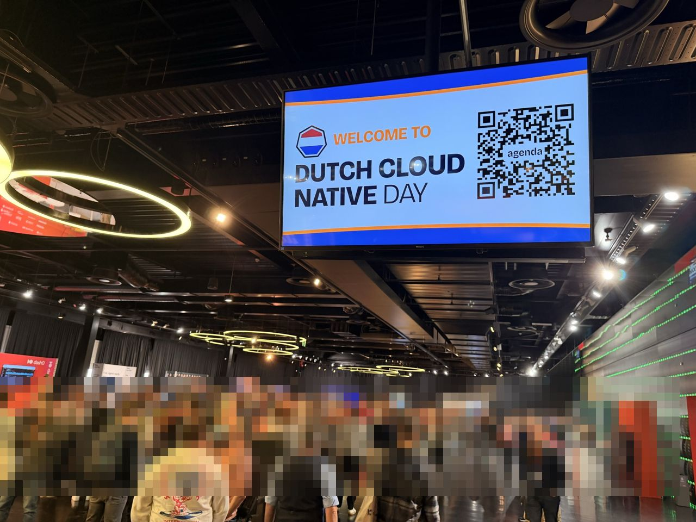

# Dutch Cloud Native Day 2026 — Notes

**Friday 30 October 2026 · Jaarbeurs, Utrecht**

I attended the conference day of Dutch Cloud Native Day 2026 and took photos of the talks instead of writing notes. These notes were compiled with the help of my AI assistant, Grok Bot. They combine what I saw on the slides I photographed with the official session abstracts and linked public sources, and each session page keeps the three clearly separated.

## Sessions

Times are local (CET).

| Time | Session | Speakers | Room |
|---|---|---|---|
| 09:45 | [Opening: Dash0 sponsor intro + The AI Adoption Ladder](sessions/01-opening-keynotes.md) | Dash0; Pini Reznik | Progress |
| 10:10 | [Two Standards Walk Into an Agent: OpenTelemetry and OpenFeature](sessions/02-otel-openfeature-agent-control.md) | Simon Schrottner | Progress |
| 10:30 | [kubectl apply -f european-sovereignty.yaml](sessions/03-european-sovereignty.md) | Orlin Vasilev | Progress |
| 11:05 | [Worktrace: Real-Time Threat Detection for Kubernetes Workspaces Using eBPF](sessions/04-worktrace-ebpf.md) | Tomas Vitvar, Jan Hlaváč | Mission 1 |
| 11:45 | [No Token Budget: What Breaks When Agentic Software Factories Run on Kubernetes](sessions/05-no-token-budget.md) | Alex Kotliarskyi | Progress |
| 12:25 | [AI Broke Your DevOps Assumptions: Privacy, IP and $40k Idle GPUs](sessions/06-ai-broke-devops-assumptions.md) | Dimitris Karakasilis | Mission 1 |
| 14:00 | [Stop Merging Blind: Argo CD Previews That Make a DIFFerence!](sessions/07-argocd-diff-preview.md) | Dag Bjerre Andersen, Tibo Beijen | Mission 1 |
| 14:40 | [Platform Engineering in the Agentic Engineering Era at RTL Netherlands](sessions/08-rtl-platform-engineering-agentic-era.md) | Anna Kosek | Progress |

## Cross-cutting themes

- **Agents are now platform users.** RTL reported 68% of merged PRs written by agents, and "No Token Budget" described a factory running about 100M tokens per minute. Talks treated agents like developers that need tools, permissions, objectives and fast feedback.
- **Safe delivery, not velocity, is the bottleneck.** Several talks focused on PR previews, rendered diffs, policy checks and keeping a human approval in the loop.
- **Isolation and runtime security.** Sandbox pods with default-deny networking, eBPF/Tetragon detection of container escapes, immutable OS images and confidential computing all came up.
- **Systems beat models.** "The advantage is not the model. It is the system around it." Hermetic environments and fast feedback loops were repeatedly called the best ROI.
- **Cost and control of AI infrastructure.** Topics included idle GPUs, low utilisation, data on someone else's hardware and European dependency on non-EU technology.
- **Open standards.** OpenTelemetry and OpenFeature were presented as a model for a portable agent-control layer (permissions, guardrails, audit). The sovereignty talk's abstract makes a similar case for cloud infrastructure: shared, open APIs (the NeoNephos projects) as the basis for provider interoperability.

## For our team

See [takeaways-for-our-team.md](takeaways-for-our-team.md) for suggested next steps.

## Credits & disclaimer

- All slide content, diagrams and figures belong to the speakers and their organisations. Photos are used here for commentary and knowledge-sharing. Any errors in the summaries are mine.
- Official agenda: https://www.dutchcloudnativeday.nl/agenda/. Recordings will be linked here when they become available.
- Image metadata (EXIF/GPS) has been removed.
- **Removal requests:** if you are a speaker or organiser and want a photo or summary changed or removed, open an issue in this repository or email mehdi@danaai.nl.

**NOTICE:** this repository has no open-source license. The notes are shared for reading and linking. Slide content remains the property of its owners.

---

Notes by DanaAI — https://danaai.nl
