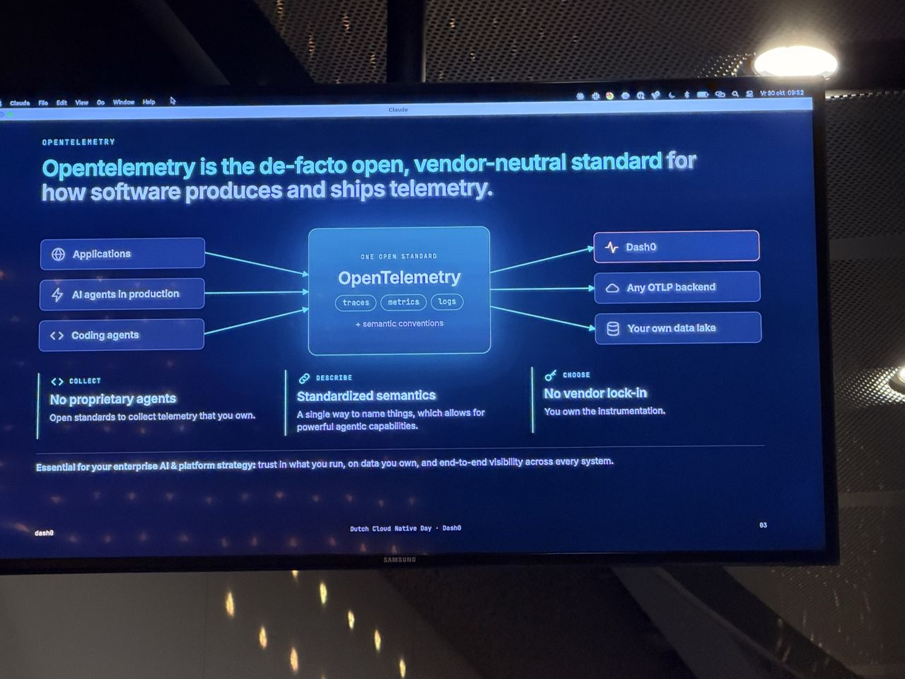
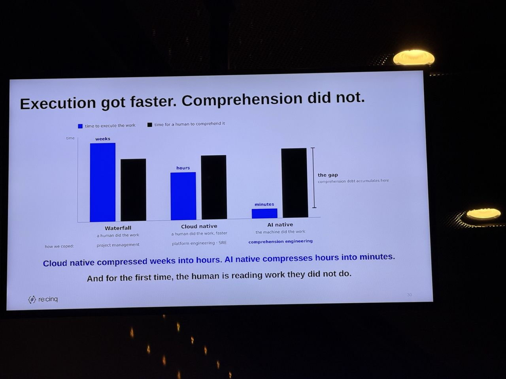
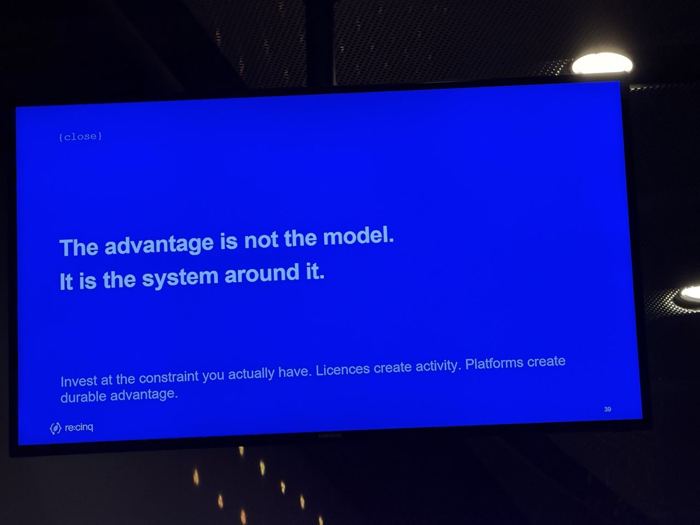

# Opening: Dash0 sponsor intro and "The AI Adoption Ladder: From First Licences to the Dark Factory"

*What I saw comes from my photos; About and Background are from the agenda and public sources linked below.*

- **Speakers:** Dash0 (platinum sponsor intro), Pini Reznik (keynote)
- **Time / room:** 09:45–10:05, Progress (main stage)
- **Agenda:** [Agenda](https://www.dutchcloudnativeday.nl/agenda/)

## What I saw

**Dash0 sponsor intro**
- OpenTelemetry was presented as the open, vendor-neutral standard for how software produces and ships telemetry. That covers applications, AI agents in production and coding agents.
- Three points were stressed: no proprietary agents, standardised semantics (semantic conventions) and no vendor lock-in ("you own the instrumentation").

**The AI Adoption Ladder**
- "Execution got faster. Comprehension did not." Cloud native compressed weeks into hours and AI native compresses hours into minutes. For the first time, the human is reading work they did not do.
- "Let the human leave the loop": today it is one human per agent, limited by working memory. The goal is one human across many agents, with the system holding what the head no longer has to.
- The factory flow: idea → intent → specification → blueprint + context → parallel agents execute → integrate → validation → human gates. Lessons from each change feed back into the factory ("the next person inherits what my change taught the factory").
- "The advantage is not the model. It is the system around it." The slide added: "Licences create activity. Platforms create durable advantage."

## About the session

*From the official abstract ([agenda page](https://www.dutchcloudnativeday.nl/agenda/), via Sessionize):* AI coding tools make individual developers faster, but delivery often does not improve at the same rate. PR volume rises, review queues grow, tests become less convincing and context gets messy. "AI did not remove the constraint; it moved it." The talk introduces the AI Coding Adoption Ladder, a model for how teams move from first licences through structured adoption and agentic workflows to software-factory patterns. It covers the order things usually break: coordination, review, testing, context, security boundaries, ownership, CI/CD and product flow. Core message: "licences create activity; platforms create durable advantage."

**Speaker:** Pini Reznik, CEO at re:cinq (per Sessionize). The Dash0 slot was a short platinum-sponsor intro with no published abstract.

## Background & further reading

*Public material on the topic. Not a record of what was said on stage.*

- re:cinq has published the ladder as a whitepaper describing nine stages from first licences to the "Dark Factory". It explains how the bottleneck moves from code generation to review, context, validation and product, and includes a self-diagnostic ([whitepaper](https://re-cinq.com/whitepapers/ai-adoption-ladder-whitepaper)).
- re:cinq's own explainer argues that a fully lights-out "dark factory" is not the right target. It recommends autonomy earned per class of work, with accountability intact, because when several human checks collapse into one, the remaining check carries more weight ([dark factory topic page](https://re-cinq.com/topics/dark-factory)).
- Dash0, the platinum sponsor, builds an OpenTelemetry-native observability product ([dash0.com](https://www.dash0.com)). The OpenTelemetry project itself is at [opentelemetry.io](https://opentelemetry.io).
