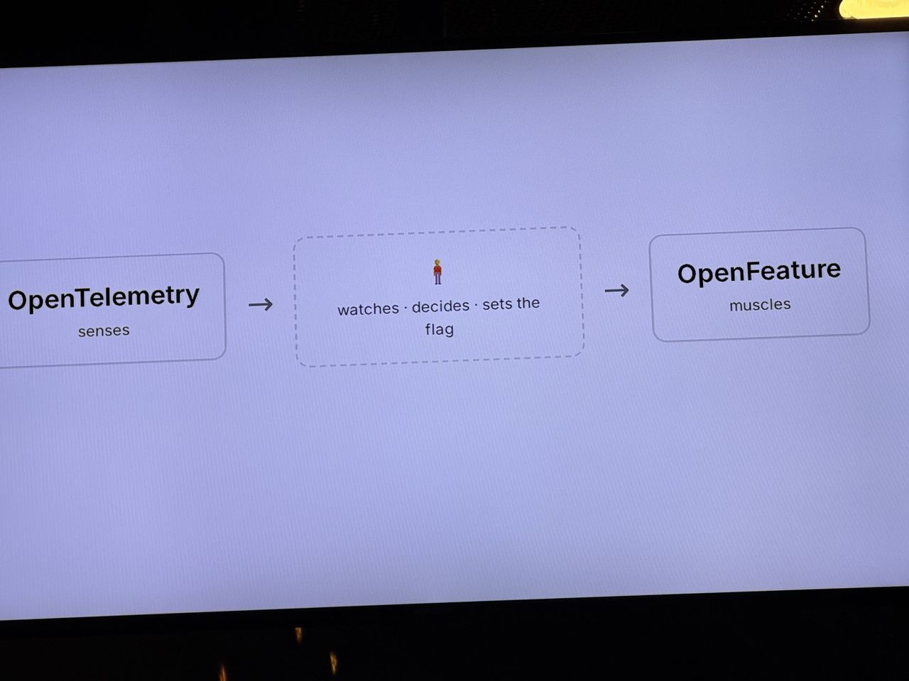
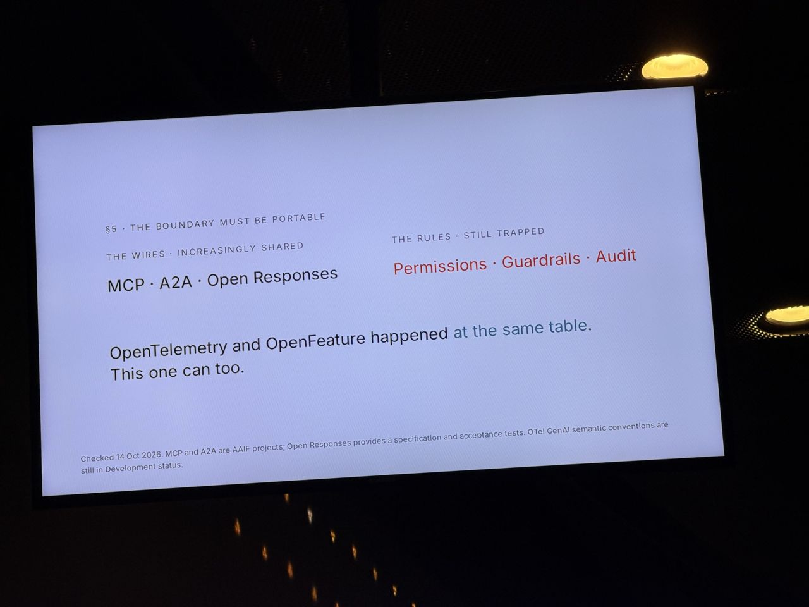

# Two Standards Walk Into an Agent: Runtime Agent Control with OpenTelemetry and OpenFeature

*What I saw comes from my photos; About and Background are from the agenda and public sources linked below.*

- **Speaker:** Simon Schrottner
- **Time / room:** 10:10–10:25, Progress
- **Agenda:** [Agenda](https://www.dutchcloudnativeday.nl/agenda/)

## What I saw
- Agent control as a loop: OpenTelemetry *senses*, an agent watches, decides and sets a flag, and OpenFeature is the *muscle*.
- Candidate areas: incident response, progressive delivery, capacity and cost, policy enforcement. The question asked was "which decisions can safely become reflexes?"
- "The boundary must be portable." The wires are increasingly shared (MCP, A2A, Open Responses), while the rules (permissions, guardrails, audit) are still trapped in individual products.
- "OpenTelemetry and OpenFeature happened at the same table. This one can too." This was a call for a shared standard for agent control.

## About the session

*From the official abstract ([agenda page](https://www.dutchcloudnativeday.nl/agenda/), via Sessionize):* Autonomous agents are being deployed without runtime control, with no open, vendor-neutral way to change what they do or see why they decided. The demo used a physical party game on a Raspberry Pi with an agent adapting the game in real time. The argument draws on history: the industry built OpenTelemetry after vendor-specific observability stacks, and OpenFeature after vendor-specific flag SDKs. Now a control layer for agents is emerging, again often vendor-specific. In the proposed model, OpenTelemetry provides observation and OpenFeature provides control. Areas covered include physical system control, infrastructure management, live model switching, permission changes and rollback without redeployment.

**Speaker:** Simon Schrottner, CNCF Ambassador and OpenFeature maintainer (per [Sessionize](https://sessionize.com/simon-schrottner/)).

## Background & further reading

*Public material on the topic. Not a record of what was said on stage.*

- OpenFeature is a CNCF vendor-neutral API and SDK specification for feature flagging. The [specification](https://openfeature.dev/specification/) defines the evaluation API and provider model, so the flag backend can be swapped without changing application code.
- OpenFeature [hooks](https://openfeature.dev/docs/reference/concepts/hooks) run around each flag evaluation, for example to emit telemetry. This is the natural integration point between flag decisions and OpenTelemetry. [flagd](https://flagd.dev) is the project's reference flag-evaluation daemon.
- OpenTelemetry has [semantic conventions for generative AI](https://opentelemetry.io/docs/specs/semconv/gen-ai/), which standardise how model calls and agent operations are described in traces and metrics. That is useful if agent behaviour is to be observed consistently across vendors.
- The speaker has a related talk, "OpenFeature as a Control Plane for OpenTelemetry", about switching telemetry verbosity at runtime via flags. It is listed on his [Sessionize profile](https://sessionize.com/simon-schrottner/) and [talks page](https://schrottner.at/talks/), which also links a recordings playlist.
- MCP ([modelcontextprotocol.io](https://modelcontextprotocol.io)) and A2A ([a2a-protocol.org](https://a2a-protocol.org)) are the open agent protocols named on the slide as the "increasingly shared wires".
