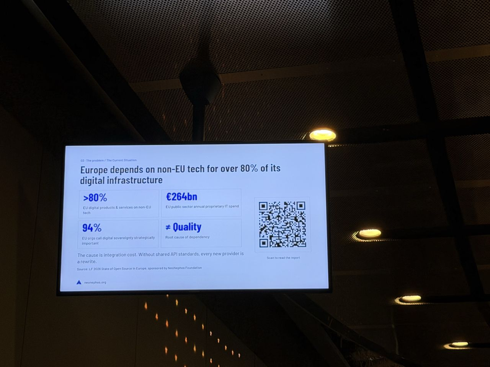

# kubectl apply -f european-sovereignty.yaml

*What I saw comes from my photos; About and Background are from the agenda and public sources linked below. I left this talk early, so I have only one photo.*

- **Speaker:** Orlin Vasilev
- **Time / room:** 10:30–10:45, Progress
- **Agenda:** [Agenda](https://www.dutchcloudnativeday.nl/agenda/)

## What I saw
- The slide headline: "Europe depends on non-EU tech for over 80% of its digital infrastructure." It also showed a €264bn figure.

## About the session

*From the official abstract ([agenda page](https://www.dutchcloudnativeday.nl/agenda/), via Sessionize):* According to the abstract, European cloud providers' market share dropped from 16% to 13% between 2020 and 2022 while the market nearly doubled. It attributes this not to quality but to integration cost: without shared API standards, every new provider means a rewrite. The NeoNephos Foundation, launched in April 2025 under Linux Foundation Europe, is presented as the open-source answer. It is a neutral home for production-proven cloud infrastructure projects whose founding members (the abstract names StackIT, SAP and Deutsche Telekom, among others) donated the IP. The abstract links this to the EU Technological Sovereignty Package (June 2026). The talk was to cover how NeoNephos projects map to the European Commission's requirements:
- signed supply-chain integrity via OCM
- Kubernetes-native IaaS via IronCore
- machine-readable service discovery via ORD
- cross-provider interoperability via Platform Mesh

Closing line: "Sovereignty isn't a data center location. It's a verifiable stack property."

**Speaker:** Orlin Vasilev, Open Source Technology Advocate (per Sessionize).

## Background & further reading

*Public material on the projects the abstract names. Not a record of what was said on stage.*

- [NeoNephos Foundation](https://neonephos.org) is hosted by [Linux Foundation Europe](https://linuxfoundation.eu). It describes its mission as advancing open-source projects aligned with the EU's IPCEI-CIS (Important Project of Common European Interest on next-generation cloud infrastructure and services). Its [project overview](https://neonephos.org/project_overview) also lists Gardener, Garden Linux, Greenhouse and others.
- [Open Component Model (OCM)](https://ocm.software) is a standard for describing software delivery artifacts, so they can be packaged, signed, transported and deployed with provenance preserved. This is the "signed supply chain" part.
- [IronCore](https://ironcore.dev) is a Kubernetes-based platform for managing bare-metal compute, storage and networking through a cloud-native API. This is the "Kubernetes-native IaaS" part.
- [Open Resource Discovery (ORD)](https://open-resource-discovery.github.io/specification/) is a protocol that lets applications and services self-describe the APIs, events and capabilities they expose.
- [Platform Mesh](https://platform-mesh.io) builds on the Kubernetes API and resource model so that services from multiple providers can be discovered, accessed and ordered with kubectl. This is the interoperability layer.
