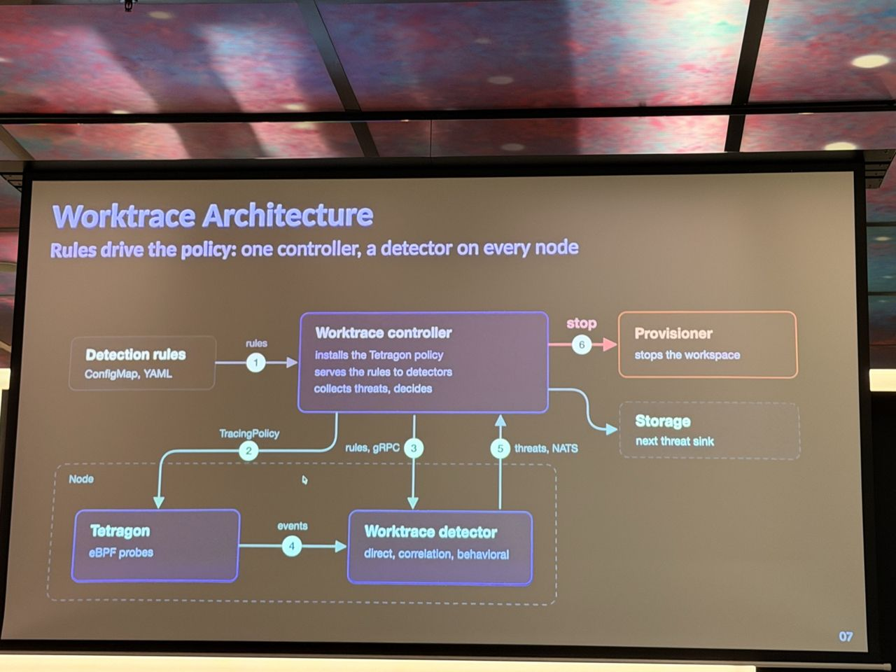
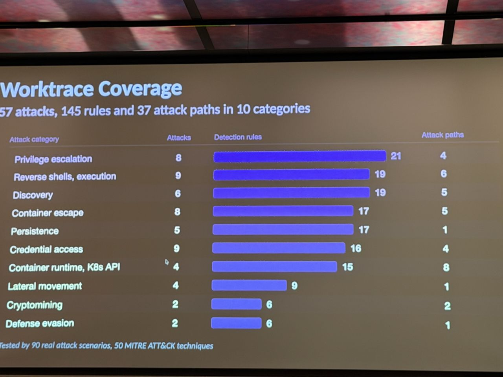

# Worktrace: Real-Time Threat Detection for Kubernetes Workspaces Using eBPF

*What I saw comes from my photos; About and Background are from the agenda and public sources linked below.*

- **Speakers:** Tomas Vitvar, Jan Hlaváč
- **Time / room:** 11:05–11:35, Mission 1
- **Agenda:** [Agenda](https://www.dutchcloudnativeday.nl/agenda/)

## What I saw
- Privilege levels for workspace containers go from standard up to privileged Podman. The guiding rule: "as little as possible, as much as the workspace workload needs".
- Workspace containers run, but escapes stop. Tetragon eBPF probes detect use of host namespaces, and the k8shell API server then stops the whole workspace at once.
- Architecture: detection rules (ConfigMap/YAML) drive one controller, which feeds a detector on every node. Results go to a provisioner (stop the workspace) and to storage.
- Three detection pipelines run on one stream of Tetragon events. *Direct* uses YAML rules on process, file or syscall. *Correlation* finds steps of an attack path within a sliding time window. *Behavioral* compares against a baseline of binaries, paths and syscalls per node.
- Coverage: 57 attacks, 145 rules and 37 attack paths in 10 categories, tested with real attack scenarios mapped to MITRE ATT&CK techniques.
- The project is open source (AGPL) under the k8shell-io GitHub organisation.

## About the session

*From the official abstract ([agenda page](https://www.dutchcloudnativeday.nl/agenda/), via Sessionize):* The talk asks what happens if Kubernetes becomes the development environment itself, not just the deployment target. That is the idea behind k8shell, the speakers' Kubernetes-native workspace project. Interactive workspaces are long-lived, user-driven and often need elevated privileges, which makes them high-value targets. Worktrace uses eBPF kernel observability to detect malicious activity inside live workspaces. It combines rule-based signatures, multi-step attack-path correlation and behavioural anomaly detection, with rules defined declaratively in YAML. It deploys as a DaemonSet alongside Cilium Tetragon. The abstract reports penetration tests across ten attack techniques (privileged-mode container escapes, kernel module injection, ptrace injection, Kubernetes privilege escalation), all detected at under 3% node CPU overhead and under 14 MiB memory per node.

**Speakers:** Tomas Vitvar, Software Engineer and Lecturer; Jan Hlaváč, Software Engineer specialising in cyber security (per Sessionize).

## Background & further reading

*Public material on the projects named. Not a record of what was said on stage.*

- The [Worktrace documentation](https://docs.k8shell.io/architecture/worktrace/) explains why standard container security tools fit poorly here. Interactive workspaces have no golden-image baseline, and "anomalous" actions such as installing packages are routine developer activity.
- Per the same docs, Worktrace consumes Tetragon events over gRPC, enriches them with workspace context and fans them out to three parallel pipelines. Routing is non-blocking, so events are dropped rather than stalling ingestion. Output is deduplicated within a time window and written as structured JSON or sent to alerting.
- [Tetragon](https://tetragon.io) attaches eBPF programs to kprobes and tracepoints, configured through [TracingPolicy](https://tetragon.io/docs/concepts/tracing-policy/) resources. It enriches events with process and Kubernetes metadata.
- [k8shell](https://k8shell.io) itself provides isolated workspaces on Kubernetes. Source is on [GitHub](https://github.com/k8shell-io).
- The coverage slide maps to [MITRE ATT&CK for Containers](https://attack.mitre.org/matrices/enterprise/containers/).
