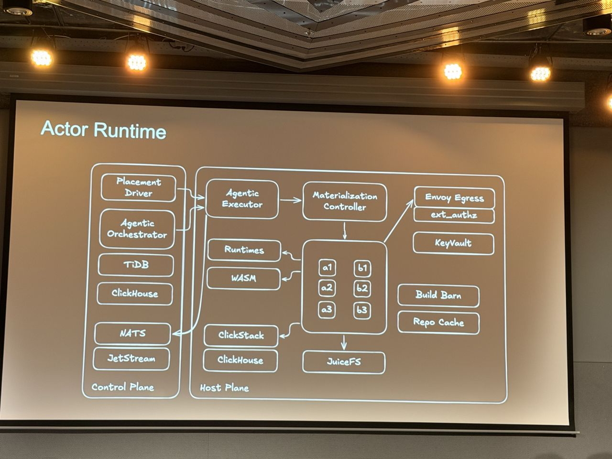
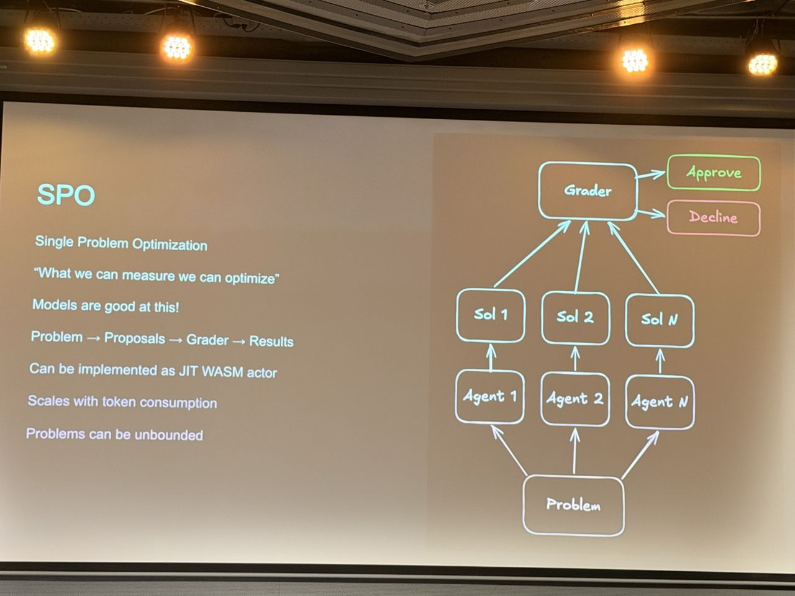
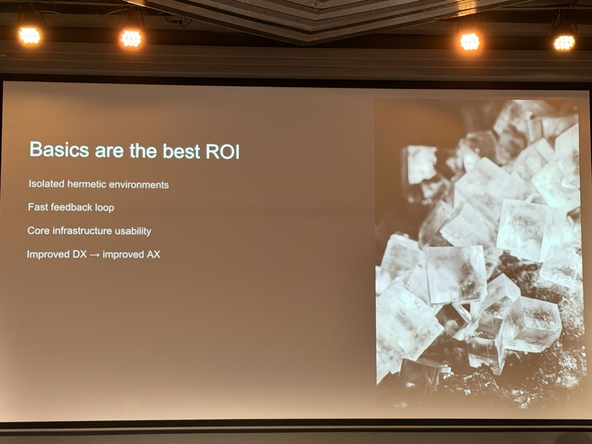

# No Token Budget: What Breaks When Agentic Software Factories Run on Kubernetes

*What I saw comes from my photos; About and Background are from the agenda and public sources linked below.*

- **Speaker:** Alex Kotliarskyi (https://frantic.im/)
- **Time / room:** 11:45–12:15, Progress
- **Agenda:** [Agenda](https://www.dutchcloudnativeday.nl/agenda/)

## What I saw
- Scale: about 100M tokens per minute was the peak sustained rate of agents running on the same codebase.
- The setup went through stages. "CodexMan" was a single chief-of-staff thread coordinating workers on stateful compute. The third attempt was an agentic system that applies real software engineering, with a mindset shift from coding to operations.
- Principles: agents write, review and ship code; treat the system as continuously evolving; reflection and self-improvement; token indifference. One section was titled "Rust and the art of not looking at the code".
- A hermetic system: self-contained dependencies (OCI registry, observability stack), built in under 2 minutes, working on its own and giving runtime signals. It runs on an actor runtime with a control plane and host plane (NATS/JetStream, TiDB, ClickHouse, WASM, JuiceFS).
- Single Problem Optimization uses a grader loop: problem → agents propose solutions → a grader approves or declines. *Finite* objectives (solve, create, fix) differ from *infinite* ones (keep production error-free, optimise performance, reduce code entropy). Deployment is graded against a baseline.
- Lessons learned:
  - Basics are the best ROI: isolated hermetic environments, a fast feedback loop, and better developer experience leading to better agent experience.
  - Treat agents as developers by giving them tools, permissions, objectives and feedback.
  - Split "brains" from "hands".
  - Fight entropy, and prefer consistency over optimal solutions.
  - Agents adapt to humans faster than humans adapt to agents.

## About the session

*From the official abstract ([agenda page](https://www.dutchcloudnativeday.nl/agenda/), via Sessionize):* This is a technical case study from OpenAI on operating agentic software factories on Kubernetes and the CNCF stack, with token budget removed as a constraint. The factories process tens of millions of tokens per minute across design, planning, implementation, testing, review, release, production monitoring, incident triage and remediation. The abstract argues that at this scale agentic development looks like a distributed cloud-native control plane, not a chatbot. The components it lists:
- workflow orchestration and event-driven queues
- Kubernetes workers and hermetic sandboxes
- MCP-style tool gateways and workload identity
- policy gates, eval systems and release controls
- trace pipelines, production-monitoring integrations and human approval flows

Once tokens stop being scarce, the bottlenecks move to cluster capacity, queue fairness, sandbox isolation, repository contention, flaky tests, release safety, feedback loops, agent alignment, multi-agent consensus and human review.

**Speaker:** Alex Kotliarskyi, "Dark Factories @ OpenAI" (per Sessionize). He writes at [frantic.im](https://frantic.im/).

## Background & further reading

*Public material by the speaker or on the same system. Not a record of what was said on stage.*

- In April 2026 the speaker co-authored an OpenAI post on [Symphony](https://openai.com/index/open-source-codex-orchestration-symphony/), an open-source agent orchestrator. Symphony turns an issue tracker such as Linear into a control plane for coding agents: every open task gets an agent in its own workspace, and crashed or stalled agents are restarted. The post says it started from a team decision to build a repository with no human-written code.
- In the same post and an accompanying [LinkedIn post](https://www.linkedin.com/posts/alex-kotliarskyi_most-engineers-using-coding-agents-eventually-activity-7454595756201582592-cuaZ), human review is moved to the end. Agents produce a proof-of-work packet (passing CI, specialist-agent reviews, a recording) before a ticket goes to human review. When results are poor, the team improves docs, rules, guardrails and skills rather than steering the agent harder.
- Both posts tie in with the "basics are the best ROI" and "treat agents as developers" lessons in my photos.
