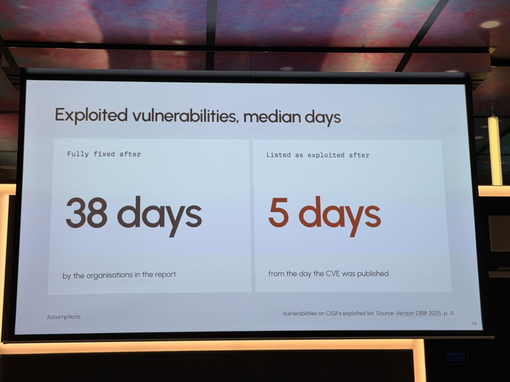
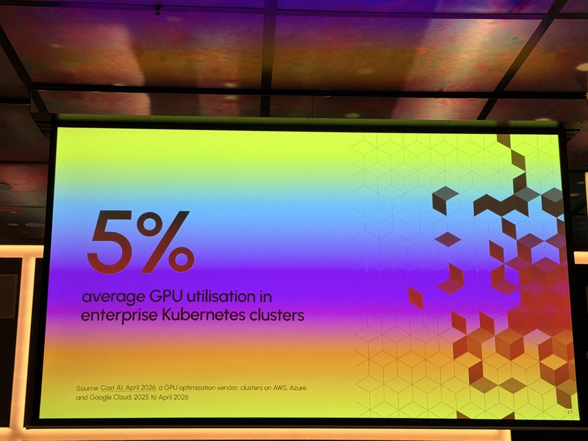
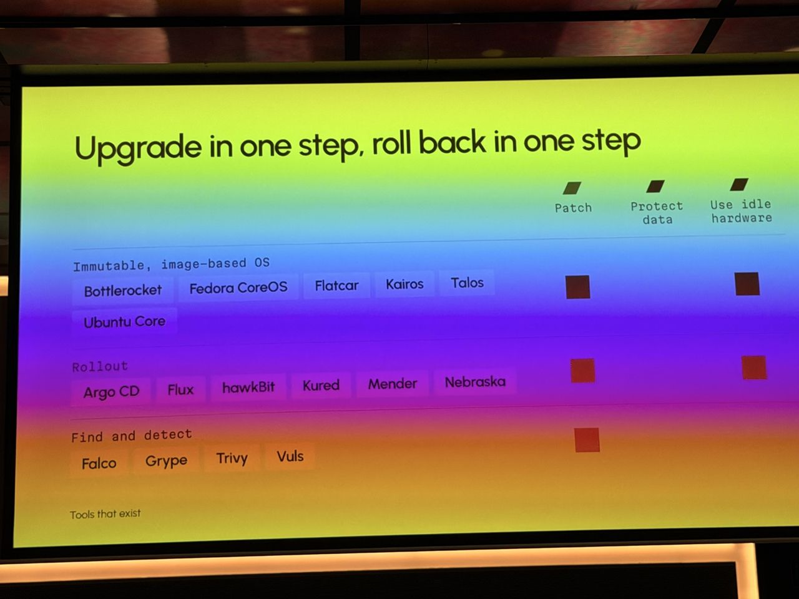

# AI Broke Your DevOps Assumptions: Privacy, IP and $40k Idle GPUs

*What I saw comes from my photos; About and Background are from the agenda and public sources linked below.*

- **Speaker:** Dimitris Karakasilis
- **Time / room:** 12:25–12:55, Mission 1
- **Agenda:** [Agenda](https://www.dutchcloudnativeday.nl/agenda/)

## What I saw
- The patch clock has collapsed at both ends. An exploit can be ready in about an hour, sometimes before the patch exists. Median figures shown: 38 days until fully fixed versus 5 days until exploited.
- The assumption "our data and models live in a datacenter we control" no longer holds. 34% of datacenter operators run most of their AI inference in colocation, and 26% of employees uploaded sensitive data to hosted AI tools.
- Idle GPUs are costly. A $40,000 GPU works out to about $1.52 per hour, or roughly $1,900 a year spent while it sits idle. Average GPU utilisation in enterprise Kubernetes clusters is 5%.
- What we need instead: patch every machine within days, protect data on hardware we don't control (at rest and in use), and use idle hardware for other work.
- Tooling shown:
  - Immutable, image-based OSes: Bottlerocket, Fedora CoreOS, Flatcar, Kairos, Talos.
  - Rollout: Argo CD, Flux and others.
  - Hardware trust: dm-verity, LUKS+TPM, Secure Boot, TPM measured boot.
  - Confidential computing: AMD SEV-SNP, Intel TDX, confidential containers.
- What immutable systems ask of you: a pipeline that builds and tests OS images, a reboot for every change, and debugging without editing the host.

## About the session

*From the official abstract ([agenda page](https://www.dutchcloudnativeday.nl/agenda/), via Sessionize):* AI workloads invalidated several DevOps habits that, the abstract argues, were never truly safe, only cheap enough to tolerate. Three are covered:
1. "We can patch on a comfortable schedule." The abstract cites Copy Fail (CVE-2026-31431), found by Theori's AI tooling in about an hour, and Dirty Frag, with exploits circulating within hours of disclosure. It also cites kernel security reports rising to 5–10 a day.
2. "Our crown jewels live in a datacenter we control." User data and model weights increasingly sit on edge, colo or rented GPU hardware. That raises the bar on trusted boot, encryption at rest, isolation and node recovery, and puts the infrastructure provider in the threat model, which is the case confidential computing addresses.
3. "An idle node is no big deal." Accelerators are scarce and costly, so machines must be re-purposed and reinstalled remotely and quickly.

The answers are immutable, image-based operating systems and other open-source tooling, ending with Kairos. Model weights stay outside the OS image, versioned as OCI artifacts or volumes and pulled at runtime.

**Speaker:** Dimitris Karakasilis, Open Source Principal Software Engineer at Spectro Cloud (per Sessionize).

## Background & further reading

*Public material on the items the abstract and slides name. Not a record of what was said on stage.*

- Copy Fail (CVE-2026-31431) is a Linux kernel local privilege escalation in the AF_ALG crypto interface. It is documented on the [disclosure site](https://copy.fail/) and in [CERT/CC VU#260001](https://kb.cert.org/vuls/id/260001), including mitigations for unpatched kernels.
- [Kairos](https://kairos.io) describes itself as a Linux framework for the full machine lifecycle: OCI image-based deployments, an immutable root filesystem, A/B atomic upgrades, and recovery/reset. It is distro-agnostic, so you can bring your own Linux image ([docs](https://kairos.io/docs/)).
- Kairos's own comparison notes that other image-based OSes differ in post-install configuration models: Talos via its API, Bottlerocket via a settings API, Flatcar and Fedora CoreOS mainly via first-boot Ignition ([kairos.io](https://kairos.io)). [Talos Linux](https://www.talos.dev) is one of the alternatives on the slide.
- For "hardware you don't fully control", the [Confidential Containers](https://confidentialcontainers.org) project (CNCF) runs Kubernetes pods inside hardware TEEs such as AMD SEV-SNP and Intel TDX, which were both listed on the slide.
