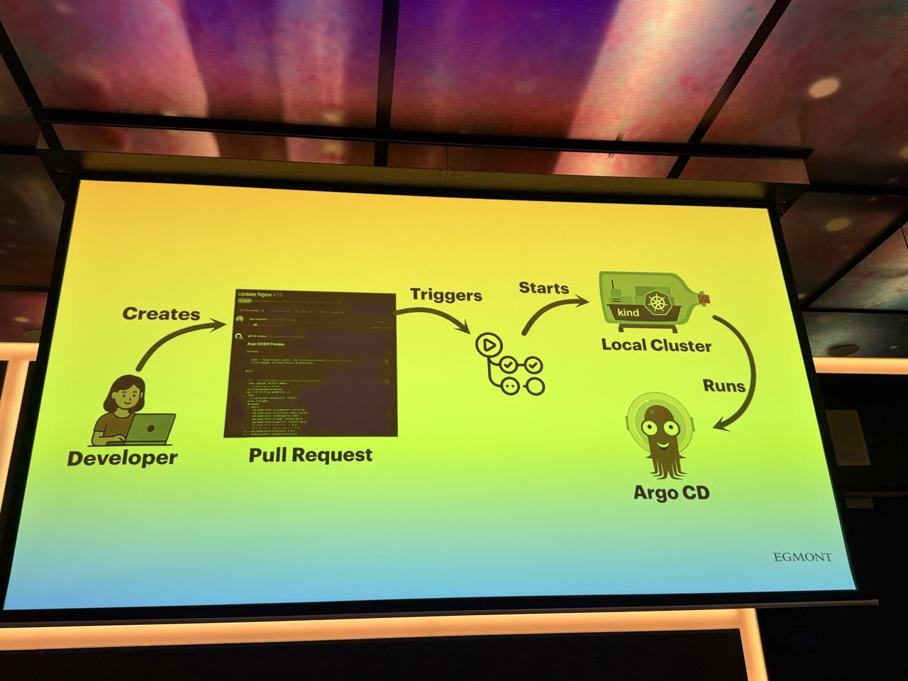
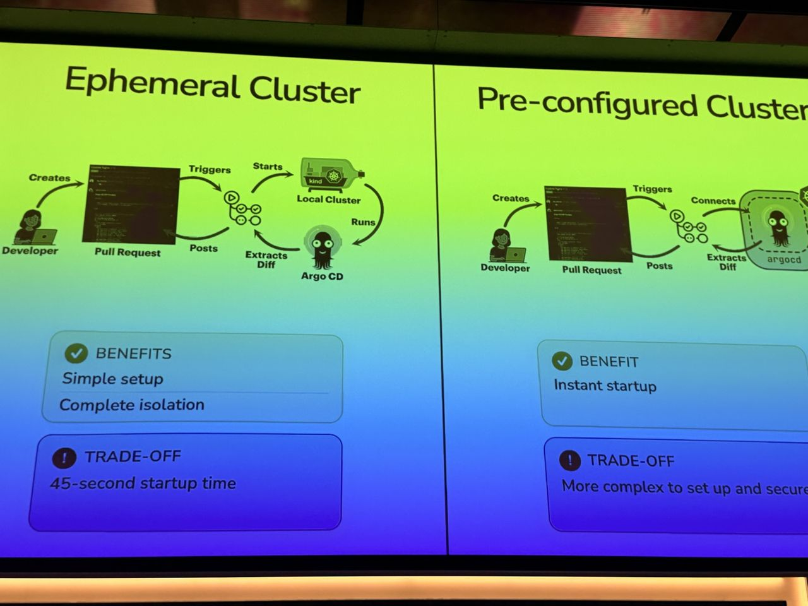
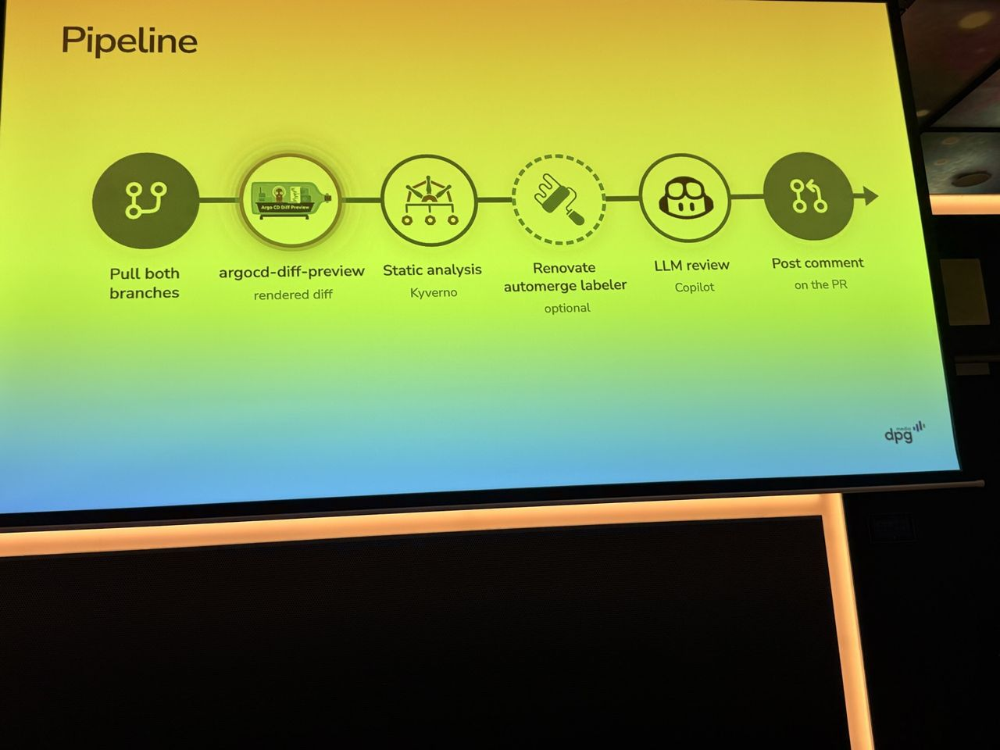

# Stop Merging Blind: Argo CD Previews That Make a DIFFerence!

*What I saw comes from my photos; About and Background are from the agenda and public sources linked below.*

- **Speakers:** Dag Bjerre Andersen, Tibo Beijen
- **Time / room:** 14:00–14:30, Mission 1
- **Agenda:** [Agenda](https://www.dutchcloudnativeday.nl/agenda/)

## What I saw
- The starting point was Terraform. The plan → review → approve → apply habit has proven effective over many years, and the GitOps equivalent is to show the *rendered* Argo CD diff in the pull request ("What You See Is What You Get").
- How argocd-diff-preview works: a pull request triggers CI, which starts a cluster running Argo CD. Argo CD renders both branches, the tool extracts the diff, and it posts the diff as a PR comment. The demos covered an Argo CD upgrade and an ApplicationSet refactor ("no changes = perfect refactor").
- There are two cluster options. An *ephemeral* cluster is simple and fully isolated, at the cost of startup time (about 45 seconds on the slide). A *pre-configured* cluster starts instantly but is more complex to set up and secure.
- It was compared with the Argo CD Source Hydrator + GitOps Promoter. The challenges listed for that approach were workflow changes, state visibility (more branches and PRs to check) and release-cycle entanglement.
- Extended pipeline: pull both branches → argocd-diff-preview → static analysis with Kyverno on the rendered manifests → optional Renovate automerge labeler → LLM review → post a comment on the PR.

## About the session

*From the official abstract ([agenda page](https://www.dutchcloudnativeday.nl/agenda/), via Sessionize):* Many teams still review GitOps pull requests by mentally parsing Helm templates and Kustomize patches, effectively "merging blind". The talk shows how to render accurate Argo CD deployment previews on PRs, based on experience at DPG Media and Egmont. It covers how previews enable safer automation, including AI-assisted reviews and automated Helm chart upgrades with Renovate, and compares argocd-diff-preview with Argo CD Source Hydrator and GitOps Promoter.

**Speakers:** Dag Bjerre Andersen, Senior Platform Engineer at Egmont and creator of argocd-diff-preview; Tibo Beijen, Platform Engineer at DPG Media (per Sessionize and their LinkedIn announcements).

## Background & further reading

*Public material by the speakers and the projects named. Not a record of what was said on stage.*

- The [argocd-diff-preview docs](https://dag-andersen.github.io/argocd-diff-preview/) list three modes: an ephemeral cluster (the default, fully isolated), pre-installed Argo CD (faster), and pre-installed Argo CD with a self-hosted runner (speed plus security). They also cover ApplicationSet generators, multi-source apps, private charts, noise filtering and Markdown/HTML output. Overhead figures are in the docs.
- Dag's original write-up, [Rendering the TRUE Argo CD diff on your PRs](https://dev.to/dag-andersen/rendering-the-true-argo-cd-diff-on-your-prs-10bk), explains the design choice. The tool compares the rendered desired state of two Git branches, not Git against the live cluster, so the output is deterministic and needs no access to production infrastructure.
- A follow-up post, [Previewing Pull Request changes in SECONDS](https://dev.to/dag-andersen/argo-cd-previewing-pull-requests-changes-in-seconds-241g), describes the pre-installed Argo CD mode.
- The alternatives compared in the talk are [Argo CD Source Hydrator](https://argo-cd.readthedocs.io/en/stable/user-guide/source-hydrator/) and [GitOps Promoter](https://github.com/argoproj-labs/gitops-promoter). Source Hydrator commits rendered manifests to a branch; GitOps Promoter handles promotion between environment branches via PRs.
- [Kyverno](https://kyverno.io/docs/) can validate the rendered manifests as a policy step in the same pipeline, as shown on the "Validate rendered output" slide.
