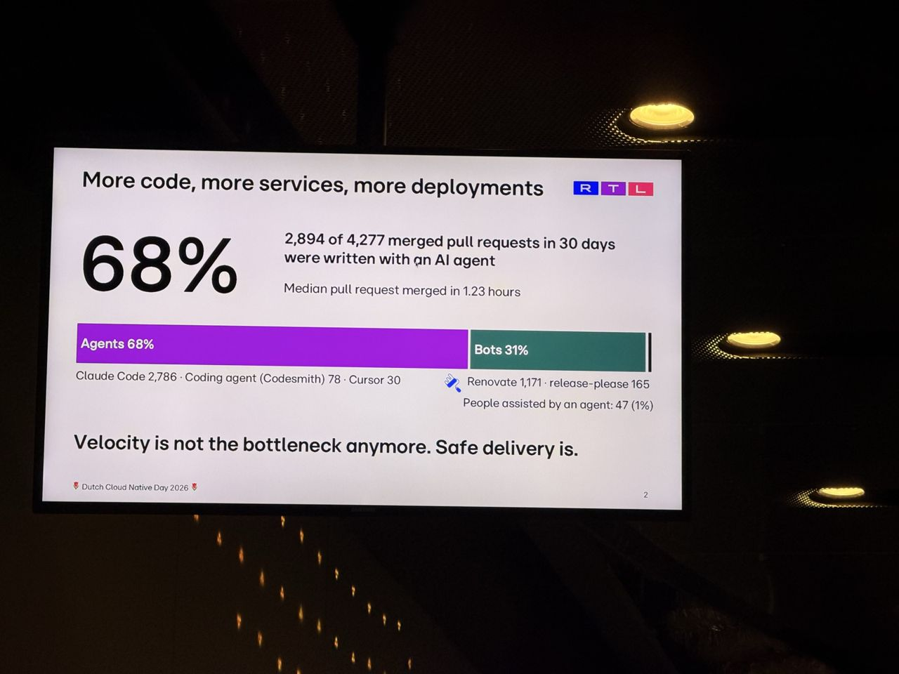
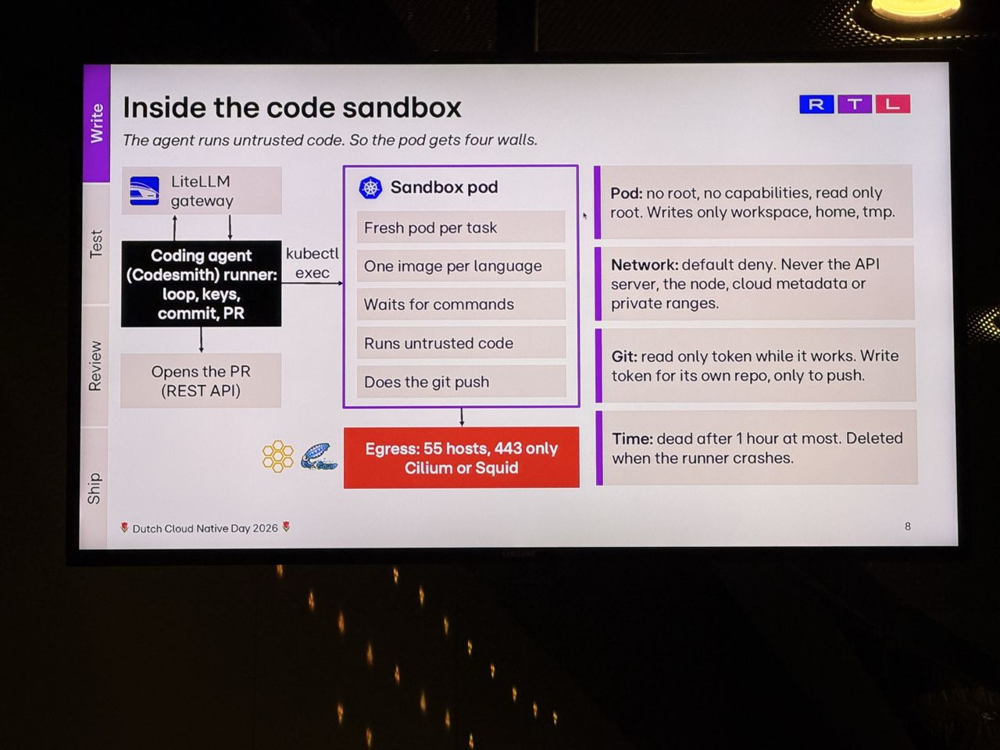
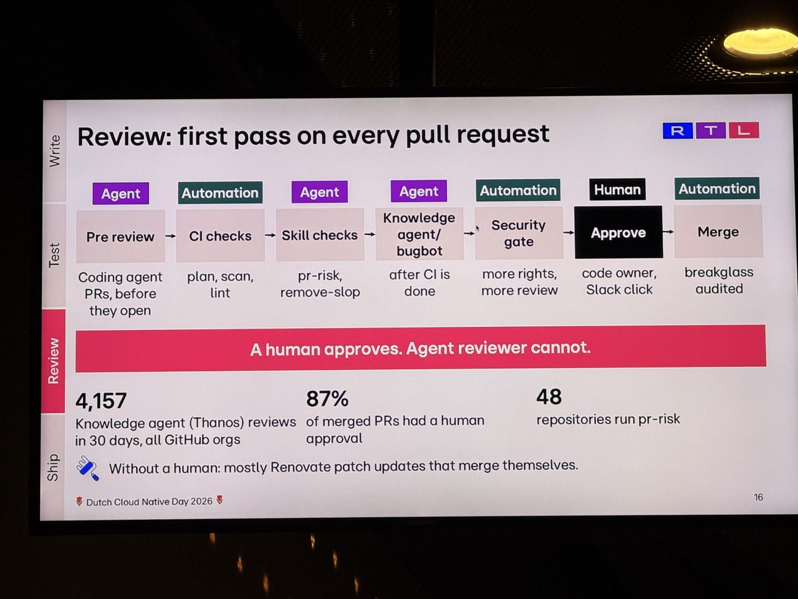

# Platform Engineering in the Agentic Engineering Era at RTL Netherlands

*What I saw comes from my photos; About and Background are from the agenda and public sources linked below.*

- **Speaker:** Anna Kosek
- **Time / room:** 14:40–15:10, Progress
- **Agenda:** [Agenda](https://www.dutchcloudnativeday.nl/agenda/)

## What I saw
My photos end around 15:00, so the last part of the talk is not covered.
- 68% of 4,277 merged pull requests in 30 days were written by an AI agent. "Velocity is not the bottleneck anymore. Safe delivery is."
- One platform sits under every RTL product (Videoland, RTL Nieuws, Buienradar), used by developers and agents alike. The slide listed 17 teams, 15 Kubernetes clusters, 1,300 Argo CD applications and 5,349 GitOps changes in 30 days.
- Changes reach production through one path for both apps and infrastructure. The path is pull request, CI checks, review, GitOps repo, Argo CD, then AKS/EKS. OpenTofu plans cover infrastructure, Gatekeeper decides what gets in, and Grafana LGTM watches every step.
- Agents need room to break things, while production needs the opposite: every change reviewed and in Git, and rollback in one step.
- The coding-agent sandbox is a fresh pod per task with no root and a default-deny network. Git access is read-only while working, with a token scoped to push its own branch. Egress is allowlisted via Cilium or Squid, and pods are deleted after an hour at most. "The agent can break the pod, but nothing outside it."
- There is one preview environment per pull request, driven by CUE intent and an ApplicationSet PR generator.
- Agents do the first review pass and a human approves ("A human approves. Agent reviewer cannot.").
- Agent skills run as CI checks with read-only tools and no LLM secret. They are advisory first, then a finding becomes a gate.

## About the session

*From the official abstract ([agenda page](https://www.dutchcloudnativeday.nl/agenda/), via Sessionize):* At RTL NL, platform engineering turns agent-driven velocity into safe, repeatable outcomes. The delivery system serves both developers and autonomous agents and is built on Argo CD, Crossplane, Kyverno, Helm, Terraform and the LGTM observability stack. The abstract names four capabilities:
1. Coding agents generate production-ready code from task descriptions.
2. Blue-green AKS deployments (dual clusters plus Terraform workspaces) give zero-downtime production flips.
3. Ephemeral per-PR preview environments use Argo CD ApplicationSet PR generators and Crossplane Compositions.
4. Automated first-pass code reviews run on every PR.

**Speaker:** Anna Kosek, Engineering Manager, Cloud and Data Platform at RTL Nederland (per Sessionize).

## Background & further reading

*Public material on the speaker's earlier work and the projects named. Not a record of what was said on stage.*

- The speaker presented [Platform Engineering at RTL Nederland](https://devopsdays.org/events/2025-amsterdam/program/platform_engineering_at_rtl_nederland/) at DevOpsDays Amsterdam 2025. That talk covered the 10 platform-engineering principles RTL uses to steer platform development, which is useful context for how this platform evolved.
- The per-PR previews build on the Argo CD [ApplicationSet Pull Request generator](https://argo-cd.readthedocs.io/en/stable/operator-manual/applicationset/Generators-Pull-Request/). It creates an Application for each open PR (optionally filtered by label, matching the "preview" label on the slide) and removes it when the PR closes.
- Cloud resources for those environments come from [Crossplane Compositions](https://docs.crossplane.io/latest/composition/compositions/), which package a set of managed resources behind one platform-defined API.
- Admission control in the change path uses [OPA Gatekeeper](https://open-policy-agent.github.io/gatekeeper/website/), per the "How a change reaches production" slide. Observability uses Grafana's [LGTM stack](https://grafana.com/oss/) (Loki, Grafana, Tempo, Mimir).
- The sandbox's egress control uses [Cilium](https://cilium.io) network policy (or Squid), and environment intent is written in [CUE](https://cuelang.org).
